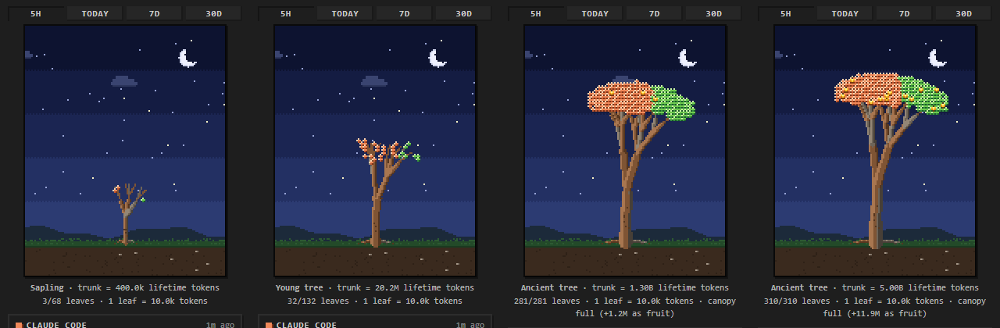

# Pixel Quota Tree

A VS Code extension that grows a **pixel-art tree** from your AI coding agents' token usage.



| Part of the tree | Meaning |
|---|---|
| **Trunk** height, girth & branch depth | Lifetime tokens across all agents (log scale: 10k → seedling, ~3B → ancient tree) |
| **Bark stripes** | Each agent's share of lifetime tokens |
| **Leaves** | Tokens in the selected window (5h / today / 7d / 30d); `1 leaf = N tokens` |
| Leaf colour & side of crown | Which agent (Claude Code = orange, left · Codex = green, right) |
| Flashing leaves | New usage since the last refresh |
| Falling leaves | Usage aged out of the window, or a quota ≥ 80% |
| Golden fruit | Canopy is full; extra usage hangs as fruit |

Click the tree to refresh. The status bar shows a compact summary.

## Data sources (local, read-only)

| Agent | Files | What is read |
|---|---|---|
| Claude Code | `~/.claude/projects/**/*.jsonl` (also `$CLAUDE_CONFIG_DIR`, `~/.config/claude`) | `message.usage` on assistant turns, de-duplicated by message+request id |
| Codex | `~/.codex/sessions/**/*.jsonl`, `archived_sessions` (or `$CODEX_HOME`) | `token_count` events: cumulative usage **and the real 5h / weekly rate-limit %** |

Files are parsed incrementally (only appended bytes), so rescans are a few milliseconds.
Nothing leaves your machine.

Claude Code logs don't include plan limits, so its quota bar comes from optional budgets you set:
`quotaTree.claude.tokenBudget5h` / `quotaTree.claude.tokenBudgetWeekly`.

## Settings

- `quotaTree.window` – `5h` | `today` | `7d` | `30d`
- `quotaTree.countCacheReads` – include cache-read tokens (off by default; they dwarf everything else)
- `quotaTree.tokensPerLeaf` – 0 = auto per window
- `quotaTree.refreshIntervalSeconds`
- `quotaTree.claude.dataDirs`, `quotaTree.codex.dataDirs` – override locations

## Develop

```sh
npm install
npm run compile      # or: npm run watch
```
Press **F5** to launch an Extension Development Host, then open the **Quota Tree** icon in the activity bar.
`npm run package` builds a `.vsix`.

## Adding another agent

Implement `UsageProvider` (`src/providers/types.ts`): return lifetime counts, 10-minute buckets and
optional quotas, then register it in `UsageService`. `JsonlScanner` handles incremental JSONL parsing.
